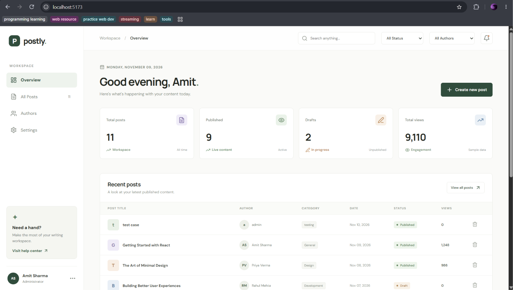
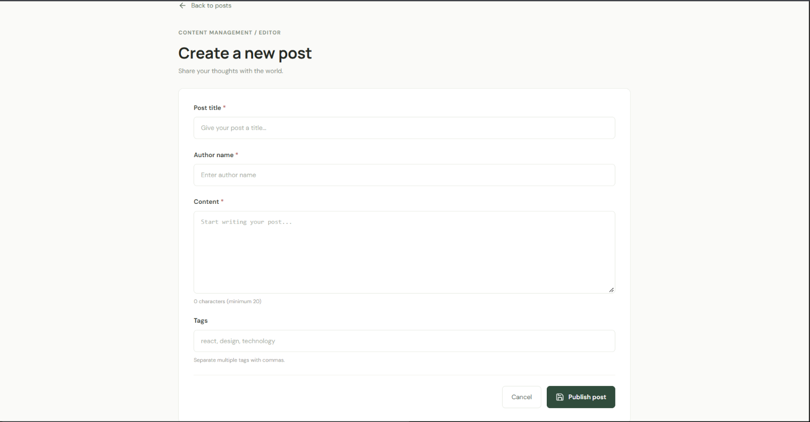
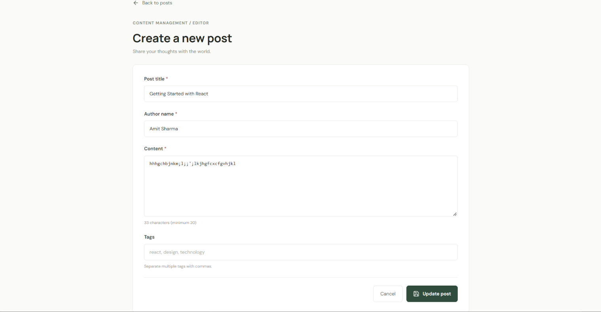

# Postly – Post Management System

Postly is a simple and user-friendly post management application built with React. I created this project to practice React concepts and understand how a real-world content management system works.

With Postly, users can create new posts, edit existing ones, delete posts, and view their complete details from a single dashboard.

## What Can You Do With Postly?

- View all posts from the dashboard.
- Create a new post with a title, author, content, and tags.
- Edit or delete existing posts.
- Search posts by title, author, or category.
- Filter posts by author and status.
- View complete post details, including tags and timestamps.
- Check author-wise post information.
- Update workspace and admin settings.
- Keep posts and settings saved using browser LocalStorage.

## Technologies Used

I used the following technologies to build this project:

- **React.js** – For building the user interface.
- **Vite** – For project setup and development.
- **JavaScript** – For application logic.
- **CSS3** – For styling and responsive layouts.
- **React Router DOM** – For navigation between pages.
- **Lucide React** – For icons.
- **LocalStorage** – For saving posts and settings in the browser.

## Getting Started

Want to run this project on your computer? Follow these steps.

### 1. Clone the repository

```bash
git clone https://github.com/AmitRaj005/-post-management-system.git
```

### 2. Open the project folder

```bash
cd post-management-system
```

### 3. Install the required packages

```bash
npm install
```

### 4. Start the development server

```bash
npm run dev
```

Now open the local URL shown in your terminal to use Postly.

## Project Structure

```text
post-management-system/
├── public/
├── src/
│   ├── components/
│   │   └── PostForm.jsx
│   ├── hooks/
│   │   └── useLocalStorage.js
│   ├── pages/
│   │   ├── PostCreate.jsx
│   │   ├── PostEdit.jsx
│   │   └── PostView.jsx
│   ├── utils/
│   │   └── validators.js
│   ├── App.jsx
│   ├── App.css
│   └── main.jsx
├── index.html
├── package.json
└── README.md
```

## Project Screenshots

### Dashboard


### Create Post


### Edit Post


### Delete Confirmation


## What I Learned

While working on this project, I got practical experience with:

- Managing state using React Hooks.
- Passing data between components using props.
- Working with React Router.
- Handling forms and input validation.
- Performing CRUD operations.
- Saving and retrieving data from LocalStorage.
- Organizing a React project into reusable components.

## A Small Note

This project is built as a frontend application and currently uses LocalStorage instead of a backend database.

Thanks for checking out my project!

**Postly – A simple way to manage your posts.**